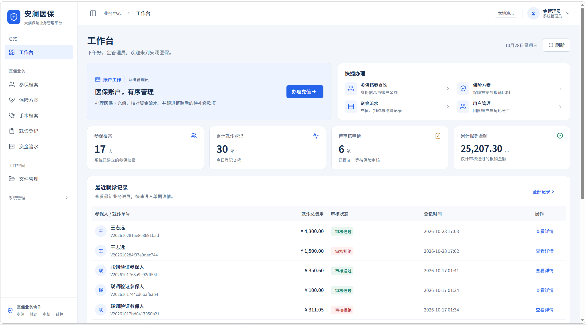

# 安澜医保 · 大病保险管理平台

基于 **Spring Boot + Vue 3** 的前后端分离管理系统，面向管理员、医院医生和保险审核员，完成参保建档、就诊计费、报销审核和资金流水管理。

**核心流程：参保建档 → 医保卡充值 → 就诊登记 → 报销审核 → 结算或拒赔补缴。**

本项目用于个人全栈学习、功能演示与简历展示。参保资料为演示数据，充值、报销及医院结算为模拟账务。

[快速启动](#快速启动windows) · [演示账号](#演示账号与角色) · [手工测试指南](docs/MANUAL-TEST-GUIDE.md) · [修复日志](docs/BUGFIX-LOG.md)



## 主要功能

| 模块           | 能做什么                                                                 |
| -------------- | ------------------------------------------------------------------------ |
| 参保与基础资料 | 维护参保人、关联保险方案，配置 A/B/C 类门诊报销比例及手术价格            |
| 就诊与计费     | 登记诊断费、多项手术及数量，实时试算总费用、拟报销额、自付额和扣款后余额 |
| 报销审核       | 查看诊疗明细和历史费率，审核通过或填写原因拒赔，保留审核轨迹             |
| 医保卡账户     | 管理员充值，记录扣款流水，处理拒赔后的欠款、部分补缴与结清               |
| 系统管理       | 管理用户、角色权限、组织、菜单、字典及操作日志                           |
| 工作空间       | 按角色展示工作台，管理个人资料和文件，支持文字搜索与移动端布局           |

更多界面：[登录页](docs/screenshots/blue-white/login-desktop.jpg) · [就诊费用试算](docs/screenshots/blue-white/visit-create-desktop.jpg) · [审核详情](docs/screenshots/blue-white/audit-detail-desktop.jpg) · [手机登录](docs/screenshots/blue-white/login-mobile.jpg) · [手机审核](docs/screenshots/blue-white/audit-detail-mobile.jpg)。截图为界面示例，账号姓名与业务数据以实际运行结果为准。

## 演示账号与角色

三个账号的初始密码均为 **`Demo@2026`**，登录时填写页面图片中的验证码。

| 账号       | 初始姓名 | 角色       | 默认职责                                           |
| ---------- | -------- | ---------- | -------------------------------------------------- |
| `admin`    | 金管理员 | 系统管理员 | 医保卡充值、欠款补缴、资金流水查询和系统配置       |
| `doctor`   | 靳医生   | 医院医生   | 新建就诊、费用试算，仅查看本人登记的就诊记录       |
| `reviewer` | 杨审核员 | 保险审核员 | 维护参保人、保险方案和手术档案，查看并审核报销申请 |

患者作为参保档案管理，没有独立的患者登录端。菜单、按钮和后端接口均按权限控制；管理员默认负责账户与系统配置，业务建档和报销审核由审核员处理。切换角色时，从右上角头像菜单退出后重新登录。

演示账号在空数据库首次启动时创建。已有数据库中的姓名、密码和业务记录以保存的资料为准；历史单据保留登记时的姓名、价格与费率。

## 快速启动（Windows）

### 1. 准备环境

- **JDK 17**。
- **Node.js 24.15 及以上的 24.x 版本**，本机已使用 24.18.0 运行。当前开发依赖也支持 Node.js 22.22.2 及以上的 22.x 版本。
- 在 PowerShell 中可以调用 `java`、`node` 和 `npm`。
- 首次启动需要联网下载 Maven 和前后端依赖；根目录 wrapper 会自动准备 Maven。

### 2. 启动项目

下载或克隆仓库后，在项目根目录打开 PowerShell，执行：

```powershell
.\start.cmd
```

也可以直接双击根目录的 `start.cmd`。看到 `Application ready` 后访问系统。

**默认使用 H2 文件数据库，无需安装 MySQL、Redis，也无需创建 `.env`。** 数据保存在 `backend/data/insurance`，停止应用后仍会保留。此命令构建并启动后端，同时启动 Vite 开发服务器。

### 3. 访问与停止

| 入口             | 地址                                                                                       |
| ---------------- | ------------------------------------------------------------------------------------------ |
| 系统页面         | [http://127.0.0.1:5173/](http://127.0.0.1:5173/)                                           |
| 后端 API         | `http://127.0.0.1:8080/api`                                                                |
| Swagger 接口文档 | [http://127.0.0.1:8080/swagger-ui/index.html](http://127.0.0.1:8080/swagger-ui/index.html) |
| OpenAPI JSON     | [http://127.0.0.1:8080/v3/api-docs](http://127.0.0.1:8080/v3/api-docs)                     |

停止应用：

```powershell
.\stop.ps1
```

启动日志位于 `logs/backend.log`、`logs/frontend.log`，错误日志为同目录下对应的 `*-error.log`。重启电脑后，重新执行启动命令即可。

## 业务流程与金额规则

建议第一次演示按以下顺序操作：

1. **审核员建档**：维护保险方案、手术项目和参保人。
2. **管理员充值**：为参保人医保卡充值。
3. **医生登记**：填写诊断、费用和手术数量，核对试算结果后提交。
4. **审核员处理**：通过后记录模拟医院结算；拒赔后补扣原拟报销金额，余额不足形成待补缴。
5. **管理员补缴**：充值后主动处理欠款，允许部分补缴，直至结清。

一个容易复算的例子：

| 项目                  |      金额 |
| --------------------- | --------: |
| 诊断费                | 100.00 元 |
| 手术费：300.00 元 × 2 | 600.00 元 |
| 总费用                | 700.00 元 |
| 按 70% 申请报销       | 490.00 元 |
| 提交时扣除自付        | 210.00 元 |

审核通过不再次扣医保卡余额。拒赔时补扣拟报销部分，最多扣至余额为零；剩余金额记录为待补缴。**充值不会自动抵扣欠款**，需要执行补缴；欠款未结清时不允许新增就诊。上述费率为演示参数。

完整操作和每一步的预期余额见 [手工测试指南](docs/MANUAL-TEST-GUIDE.md)。

## 技术栈与实现重点

| 层次     | 技术与用途                                                           |
| -------- | -------------------------------------------------------------------- |
| 前端     | Vue 3、TypeScript、Vite、Element Plus；组件、表单、路由与角色页面    |
| 图表     | ECharts、Vue-ECharts；按需加载、数据更新及容器尺寸适配               |
| 后端     | Java 17、Spring Boot 3.5、Spring Security、MyBatis-Plus              |
| 数据库   | MySQL 8 用于业务模式；H2 文件库用于快速演示，H2 内存库用于自动化测试 |
| 验证码   | Redis 保存一次性验证码并控制过期；默认演示模式使用内存缓存           |
| 接口文档 | springdoc-openapi 自动生成 OpenAPI 与 Swagger UI                     |

- **服务端计费**：从数据库读取价格与费率，使用十进制金额计算及统一舍入，保证总费用 = 自付额 + 拟报销额。
- **历史快照**：就诊单保存当时的手术价格、数量和报销费率，后续修改基础资料不会改写旧单费用。
- **事务与幂等**：结合事务、账户行锁及请求标识，处理重复提交、并发扣款和重复审核。
- **身份与权限**：随机 Bearer 会话令牌，服务端保存哈希与有效期；后端校验功能权限、医生单据归属及文件访问权限。
- **查询交互**：统一处理中文输入提交、清空与重置，仅接受最后一次查询的结果，防止旧请求覆盖新筛选。

详细设计见 [业务与架构设计](docs/PROJECT-DESIGN.md)，接口字段见 [API 约定](docs/API-CONTRACT.md)。

## MySQL 与 Redis（可选）

默认演示方式足以体验业务。需要使用 MySQL、Redis 时，选择下面一种方式。

<details>
<summary><strong>方式一：Docker Compose</strong></summary>

先安装并启动 Docker Desktop，在项目根目录执行：

```powershell
if (-not (Test-Path .env)) {
    Copy-Item .env.example .env
}
```

已有 `.env` 时直接编辑现有文件。填写自己的 `DB_PASSWORD`，并将 `REDIS_ENABLED` 改为 `true`。示例配置中的数据库端口 `3307`、Redis 端口 `6380` 与 Compose 配置对应。

然后启动：

```powershell
.\start.cmd -WithContainers
```

脚本会启动 MySQL 和 Redis 容器，再以 `mysql` 模式启动应用。数据库容器已有数据时，`.env` 中的账号密码需要与库内现有账号一致。

停止应用仍使用 `.\stop.ps1`；暂停容器使用：

```powershell
docker compose -p insurance_portfolio stop
```

Compose 配置已提供；目前验证记录中的实际 MySQL、Redis 联调使用独立本机服务，容器启动方式尚未实际验收。

</details>

<details>
<summary><strong>方式二：使用已有 MySQL、Redis</strong></summary>

准备 MySQL 8、数据库及应用账号。仅在没有 `.env` 时将 `.env.example` 复制为 `.env`；已有文件时直接编辑。填写 `DB_URL`、`DB_USERNAME`、`DB_PASSWORD`。需要 Redis 验证码时，填写 Redis 连接信息并设置 `REDIS_ENABLED=true`；使用内存验证码时设置为 `false`。

```powershell
.\start.cmd -Profile mysql
```

开发者本机还提供 `.\start.cmd -WithLocalServices`，它依赖事先准备的 `.tools`、独立 MySQL 数据和 WSL Redis。这些本机文件不随 Git 仓库分发。

</details>

## 项目结构与文档

```text
backend/                 Spring Boot 后端、数据库模型及集成测试
frontend/                Vue 前端、页面组件及回归测试
docs/                    业务设计、接口说明、截图与修复记录
scripts/                 启动与联调辅助脚本
compose.yml              MySQL、Redis 容器配置
.env.example             本地环境配置示例
start.cmd / stop.ps1     Windows 应用启动、停止入口
```

| 想了解的内容                   | 文档                                      |
| ------------------------------ | ----------------------------------------- |
| 如何手工测试完整业务           | [手工测试指南](docs/MANUAL-TEST-GUIDE.md) |
| 费用、审核、事务与权限如何设计 | [项目设计](docs/PROJECT-DESIGN.md)        |
| 接口地址、请求与返回字段       | [API 约定](docs/API-CONTRACT.md)          |
| 已执行哪些检查、结果与范围     | [验证记录](docs/VERIFICATION.md)          |
| 问题原因、修复内容与复测步骤   | [问题与修复日志](docs/BUGFIX-LOG.md)      |
| 如何按模块学习并准备面试       | [全栈学习路线](docs/LEARNING-PATH.md)     |
| 开源项目参考与实际复用范围     | [开源复用记录](docs/OPEN-SOURCE-REUSE.md) |
| 界面设计参考与改版范围         | [界面参考](docs/UI-REFERENCES.md)         |

## 自行测试与构建

手工操作可直接使用上面的演示账号，按 [测试指南](docs/MANUAL-TEST-GUIDE.md) 建立专用测试资料。

后端自动化测试，在项目根目录执行：

```powershell
.\mvnw.cmd -f backend/pom.xml test
```

需要生成后端 JAR 时，先停止应用，避免 Windows 下运行中的 JAR 被占用：

```powershell
.\stop.ps1
.\mvnw.cmd -f backend/pom.xml -DskipTests package
```

前端自动化测试、类型检查和生产构建：

```powershell
cd frontend
npm ci
npm test
npm run build
```

覆盖内容包括费用核算、权限与数据范围、幂等与并发审核、拒赔补缴、图表、中文搜索和查询请求顺序。不同日期的执行范围和结果见 [验证记录](docs/VERIFICATION.md)。

Swagger 的受保护接口需要先通过验证码和登录接口取得令牌，再在 **Authorize** 中填写令牌。文档默认开启，设置 `API_DOCS_ENABLED=false` 可关闭 JSON 和 UI。

## 常见问题

| 现象                             | 处理方式                                                                    |
| -------------------------------- | --------------------------------------------------------------------------- |
| 浏览器提示无法访问站点           | 在项目根目录执行启动命令，等到 `Application ready`，再打开 `127.0.0.1:5173` |
| 提示 8080 或 5173 已占用         | 检查是否已有项目实例；本项目实例可先用 `.\stop.ps1` 停止                    |
| 依赖安装提示 Node 版本不符合要求 | 使用上面列出的 Node 版本，再在 frontend 目录执行 npm ci                     |
| MySQL 连接或认证失败             | 检查数据库是否启动，以及 `.env` 中的地址、端口、库名和账号密码              |
| 更新代码后页面仍显示旧内容       | 刷新页面；前端依赖发生变化时，在 `frontend` 重新执行 `npm ci` 后启动        |

## 项目范围与来源

当前项目提供本机运行与演示流程，未接入真实医保、银行支付或短信平台，未部署公网，也未进行生产容量或真实业务合规验证。

使用的开源依赖、参考来源及许可说明见 [开源复用记录](docs/OPEN-SOURCE-REUSE.md) 和 [第三方声明](THIRD-PARTY-NOTICES.md)。

## 修复日志
修复日志路径：docs/BUGFIX-LOG.md
里面包含了近期测试所出现的bug
