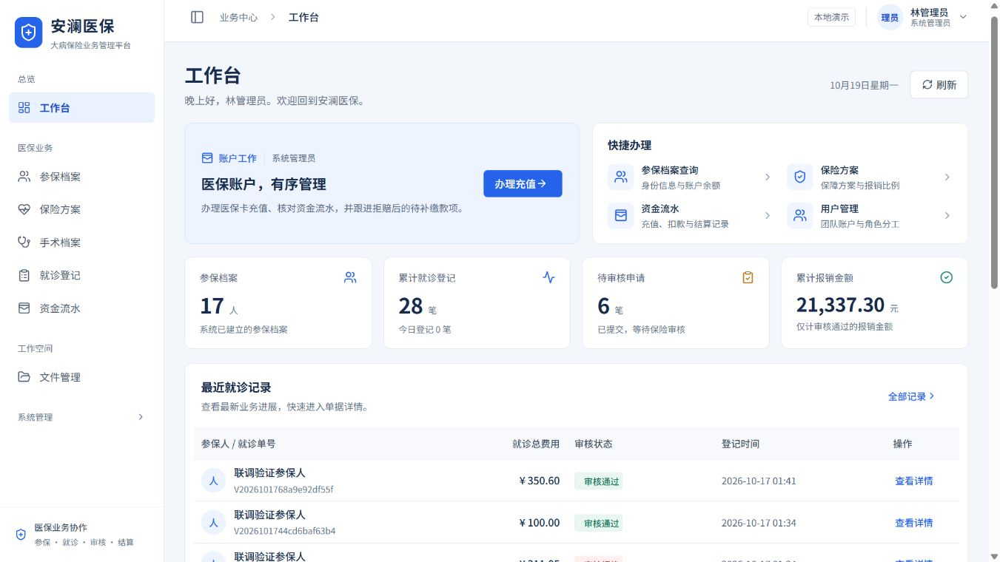

# 安澜医保 · 大病保险管理平台

Spring Boot + Vue 全栈学习与简历项目。以大病保险管理系统为业务基础，重新设计管理界面，并补齐计费、资金流水、审核与待补缴规则。

## 项目范围

三个登录角色：系统管理员、医院医生、保险审核员。患者作为参保档案管理。充值、报销和医院结算均为模拟账务，不连接真实医保、支付、银行或短信平台。

- 参保人员档案、医保卡充值、资金流水与待补缴。
- 医疗保险与 A/B/C 门诊报销率、手术档案及价格。
- 就诊登记、多项手术与数量、服务端计费、价格和费率快照。
- 报销审核、拒绝原因、余额不足时的部分扣款与后续补缴。
- 按角色控制菜单、按钮与后端接口，医生查看本人就诊记录。
- 用户、组织、角色权限、菜单、字典、日志、文件和个人中心。

## 界面与工作空间

前端采用蓝白医保业务布局，参考 TRICARE 的工作台组织与 Wemind 的信息层级。白色侧栏区分业务与系统配置，系统菜单可折叠；14px 表格正文、分区表单、费用摘要和审核抽屉让处理重点更清楚。工作台按三个角色展示对应任务，登录和业务页面适配 390px 手机屏幕。



| 页面           | 桌面截图                                                                  | 手机截图                                                              |
| -------------- | ------------------------------------------------------------------------- | --------------------------------------------------------------------- |
| 登录与演示角色 | [登录页](docs/screenshots/blue-white/login-desktop.jpg)                   | [390px 登录页](docs/screenshots/blue-white/login-mobile.jpg)          |
| 管理员工作台   | [任务与近期业务](docs/screenshots/blue-white/dashboard-admin-desktop.jpg) | —                                                                     |
| 就诊与费用试算 | [就诊登记与费用卡](docs/screenshots/blue-white/visit-create-desktop.jpg)  | —                                                                     |
| 报销审核       | [审核详情抽屉](docs/screenshots/blue-white/audit-detail-desktop.jpg)      | [390px 审核详情](docs/screenshots/blue-white/audit-detail-mobile.jpg) |

设计来源、改版前的问题与落地范围见 [界面参考与改版记录](docs/UI-REFERENCES.md)。上述页面已使用三个演示账号进行只读登录检查及费用试算；本轮未执行充值、就诊提交或审核决定等业务写入。

## 技术与结构

后端 Java 17 / Spring Boot 3.5 / Spring Security / MyBatis-Plus / MySQL 8；前端 Vue 3 / TypeScript / Vite / Element Plus / ECharts。验证码支持 Redis，独立 demo 模式使用内存缓存与 H2。

登录会话在数据库中保存令牌哈希和过期时间；Redis 用于一次性验证码及 120 秒过期控制。MySQL 与 Redis 的实际联调证据见 `docs/VERIFICATION.md`。

```text
backend/                  后端代码与业务集成测试
frontend/                 前端页面、组件与接口调用
docs/API-CONTRACT.md       接口和业务规则
docs/PROJECT-DESIGN.md     模型、状态流转、事务与权限说明
docs/OPEN-SOURCE-REUSE.md  GitHub 候选比较、复用范围与优化依据
THIRD-PARTY-NOTICES.md    新增开源依赖的许可与声明
scripts/                  前后端启动与验证脚本
compose.yml               MySQL / Redis 本地容器
```

## 本地运行（Windows）

需要 JDK 17+、Node.js 22.12+。根目录 `mvnw.cmd` 首次使用会下载并校验 Maven，不需要单独安装 Maven。

快速演示：双击 `start.cmd`，或在项目根目录运行：

```powershell
.\start.cmd
```

访问 http://127.0.0.1:5173。首次构建会下载依赖，进度在 `logs/` 下。后端为 http://127.0.0.1:8080。

接口文档：[Swagger UI](http://127.0.0.1:8080/swagger-ui/index.html)；机器可读的 [OpenAPI JSON](http://127.0.0.1:8080/v3/api-docs)。先调用验证码和登录接口，取得 `data.token` 后在文档的 Authorize 中输入令牌，再调试受保护接口。实际写操作会修改当前演示数据库。

文档默认开启，设置环境变量 `API_DOCS_ENABLED=false` 可同时关闭 JSON 和 UI；使用 mysql profile 时也可以把它写进 `.env`。Bearer 会话采用随机令牌和服务端哈希存储。

| 账号     | 密码      | 角色       |
| -------- | --------- | ---------- |
| admin    | Demo@2026 | 系统管理员 |
| doctor   | Demo@2026 | 医院医生   |
| reviewer | Demo@2026 | 保险审核员 |

这些账号仅用于本机演示。数据库持久化位置由对应 profile 配置决定。

使用 MySQL 和 Redis：配置 `.env`（参考 `.env.example`），启动 Docker Desktop 后运行：

```powershell
.\start.cmd -WithContainers
```

容器端口是 MySQL `3307`、Redis `6380`，与常见本机服务端口分开。已拥有数据库和 Redis 时，配置 `.env` 后运行 `.\start.cmd -Profile mysql`。如暂不使用 Redis，设置 `REDIS_ENABLED=false`。

当前电脑已在 `.tools/` 准备独立 MySQL 数据与 WSL Redis，可运行 `.\start.cmd -WithLocalServices` 使用它们。该选项复用本机已准备的运行时；复制到其他电脑时请采用容器方案或配置自己的服务。

分别在两个终端运行，便于学习调试：

```powershell
.\scripts\start-backend.ps1 -Profile demo
```

```powershell
.\scripts\start-frontend.ps1
```

停止由 `start.cmd` 创建的进程：`.\stop.ps1`。容器和业务数据会保留；需要暂停容器时使用 `docker compose -p insurance_portfolio stop`。

## 验证

后端业务集成测试：

```powershell
.\mvnw.cmd -f backend/pom.xml test
```

前端图表回归、类型检查与构建：

```powershell
Set-Location frontend
npm test
npm run build
```

测试结果与实际验证范围记录在 `docs/VERIFICATION.md`，不将未执行的检查写成已通过。

## 推荐演示顺序

准备自己测试时，按 [手工测试指南](docs/MANUAL-TEST-GUIDE.md) 建立专用数据；其中提供审核通过、拒赔与部分补缴的每一步金额预期。

1. 审核员查看参保人员、保险报销比例和手术价格。
2. 管理员为患者充值，核对资金流水。
3. 医生选择患者、添加手术并调整数量，查看服务端报价后登记。
4. 审核员审核，演示通过和拒绝两种分支。
5. 管理员处理待补缴，核对余额、费用快照和审核记录。
6. 切换角色，展示菜单与接口权限差异。

先阅读业务设计，再按学习路线分模块调试。简历描述以实际实现和测试证据为准。

GitHub 调研及实际复用内容见 [开源复用记录](docs/OPEN-SOURCE-REUSE.md)。本轮以 Vue-ECharts 优化首页图表，以 springdoc 生成接口文档；课程原仓库与管理模板用于分析和比较。
