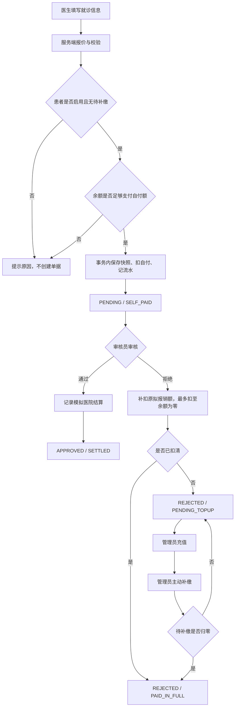
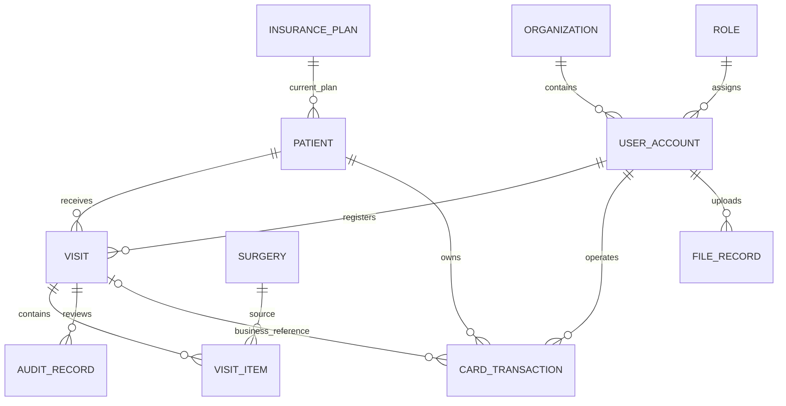

# 大病保险管理系统：项目设计与业务口径

本文说明课程需求如何落成可实现、可核对的全栈项目。功能与接口以 [API-CONTRACT.md](./API-CONTRACT.md) 为共同约定；本文记录设计目的和业务解释，功能是否完成以代码及验证记录为准。

## 1. 项目目标与边界

项目基于课程中的城乡居民大病保险场景，面向个人全栈学习、项目演示和简历展示。保留参保、医保卡充值、就诊登记、报销审核和基础管理业务，优化页面组织和工程实现。

保险名称、A/B/C 门诊类别、费率及演示人员均属于本项目的模拟数据。系统不连接真实医保、医院收费、银行支付或短信平台。审核通过后的“向医院结算”是系统内的模拟结算记录。

技术采用前后端分离的模块化单体：

| 部分 | 本项目约定 | 作用 |
| --- | --- | --- |
| 前端 | Vue 3、TypeScript、Vite、Element Plus、ECharts | 页面、路由、表单交互、图表和接口调用 |
| 后端 | Java 17、Spring Boot 3.5.x、Spring Security、MyBatis-Plus | 身份权限、业务规则、事务和持久化 |
| 业务数据库 | MySQL 8 | 保存业务记录、账户余额、资金流水和历史快照 |
| 本地 demo | H2 | 降低首次启动和基础测试门槛 |
| 可选基础设施 | Docker Compose 中的 MySQL、Redis | 提供可复用的本地服务环境 |

课程原前端使用 Vue、View UI，首页还包含 jQuery；本项目用 Vue 3 组件组织页面与图表。架构图包含 Redis，但提供 Redis 容器不等于应用已实现 Redis 缓存；具体用途须在相应功能落地、验证后说明。第一版不拆微服务，也不因架构图中的“负载均衡”字样引入多节点部署。

## 2. 课程原要求与本版补充规则

| 主题 | 课程已明确内容 | 本版为完成业务闭环而补充的规则 |
| --- | --- | --- |
| 用户角色 | 医生、保险审核员、管理员 | 图中的患者作为参保业务对象，不另做患者登录端；后端同时校验功能权限和数据范围 |
| 参保 | 维护参保人员、保险资料并关联 | 第一版参保人员关联一个当前保险方案；就诊时复制适用费率，后续改动不改写历史 |
| 充值 | 管理员充值，上限 50000 元 | 上限按单次充值理解：`0 < amount <= 50000`，不作为账户总余额上限；充值不自动抵扣待补缴 |
| 计费 | 保险分三种类型；按 A/B/C 门诊比例计算；选择手术、数量和诊断原价 | 比例统一解释为报销比例；诊断费独立于手术费，计算公式见下一节 |
| 就诊 | 医生登记；先扣自费，医院垫报销部分 | 自费扣款、资金流水、费用快照及待审核单须在同一事务完成；自费余额不足则整笔提交失败 |
| 审核通过 | 记录向医院结算 | 用模拟结算状态记录，不调用真实支付；不再从医保卡扣款 |
| 审核不通过 | 从医保卡追加扣除原拟报销部分 | 第一版“退回”视为最终拒赔，不能重新提交审核；余额不足时扣可用余额，剩余金额成为待补缴 |
| 补缴 | 原要求未完整说明 | 管理员主动补缴，允许部分补缴；参保人员存在待补缴时，不允许新增就诊 |
| 重复操作 | 原要求未完整说明 | 充值、就诊提交、审核和补缴都使用 `requestId` 防止重复记账 |
| 历史数据 | 原要求未完整说明 | 已被业务引用的参保人员、保险、手术不物理删除；停用不影响历史查询 |

这些补充规则是项目中的实现选择，不代表任何地区的真实医保政策。也不由系统自行扩展起付线、封顶线、年度累计报销、跨地区结算或商保理赔规则。

## 3. 费用公式与金额口径

设独立诊断费为 `D`，第 `i` 项手术单价为 `Pi`、数量为 `Qi`，参保保险在所选门诊类别下的报销率为 `R`：

```text
手术费 S = Σ(Pi × Qi)
总费用 T = D + S
拟报销额 C = round(T × R, 2, HALF_UP)
自付额 P = T - C
```

金额单位为元。服务端使用十进制金额类型进行计算，最终报销额按 `HALF_UP` 保留两位小数，再以总额减报销额得到自付额，保证 `T = P + C`。不分别舍入两个比例后相加，避免一分钱差额。

- 前端提交患者、门诊类别、诊断费、手术标识和数量；手术单价、保险方案和费率由后端读取。
- 费率在 `0～1` 之间；数量为正整数；诊断费和手术单价不得为负。
- `/visits/quote` 是报价预览，不扣款、不占用余额、不生成就诊单。
- 提交时重新读取并计算当时有效的资料，保存最终快照。报价与提交之间发生费率或手术价格变更时，以提交成功返回的单据为准；页面应展示最终结果。
- `claimAmount` 保存当时的拟报销额，拒赔后也不改成零。它用于解释原计费过程，不能直接当成“保险已结算金额”。
- 首页累计已报销金额只统计审核通过的模拟结算额，不能把待审核、已拒赔金额一起累加。

### 可复算的演示案例

以下费率只为解释本项目公式，不是政策参数。

```text
手术单价 300.00 元，数量 2
诊断费 100.00 元
所选门诊报销率 70%
总费用 = 100.00 + 300.00 × 2 = 700.00 元
拟报销额 = 700.00 × 70% = 490.00 元
自付额 = 700.00 - 490.00 = 210.00 元
```

初始医保卡余额为 300.00 元，提交后扣 210.00 元，余额为 90.00 元，待审核金额为 490.00 元。

| 后续动作 | 余额变化 | 待补缴 | 结果 |
| --- | --- | --- | --- |
| 审核通过 | 不变，仍为 90.00 | 0.00 | 记录模拟结算 490.00，单据结清 |
| 或者：审核拒绝 | 扣当前余额 90.00，余额变 0.00 | 400.00 | 拒赔，等待补缴 |
| 拒赔后充值 200.00 | 余额变 200.00 | 仍为 400.00 | 充值成功，尚未执行补缴 |
| 管理员执行补缴 | 扣 200.00，余额变 0.00 | 200.00 | 部分补缴，仍不能新增就诊 |
| 再充值 250.00 并补缴 | 扣 200.00，余额剩 50.00 | 0.00 | 拒赔单据全部自费结清 |

“审核通过”和“审核拒绝”是互斥分支，不能依次发生在同一张单据上。

## 4. 就诊、审核与支付状态机

审核状态回答“是否同意报销”，支付状态回答“本单费用如何结清”。两者独立存储，避免一个状态混合两种含义。

| 审核状态 `auditStatus` | 支付状态 `paymentStatus` | 含义 |
| --- | --- | --- |
| `PENDING` | `SELF_PAID` | 初始自付已完成，等待报销审核 |
| `APPROVED` | `SETTLED` | 审核通过并记录模拟医院结算 |
| `REJECTED` | `PAID_IN_FULL` | 审核拒绝，但原拟报销部分已从卡内扣清 |
| `REJECTED` | `PENDING_TOPUP` | 审核拒绝，仍有金额待补缴 |



拒赔时的计算为：

```text
本次补扣 = min(当前卡余额, 拟报销额)
待补缴 = 拟报销额 - 本次补扣
```

之后每次主动补缴：

```text
本次补缴 = min(当前卡余额, 本单待补缴)
剩余待补缴 = 原待补缴 - 本次补缴
```

余额为零时补缴不能伪造一笔有金额的成功扣款。参保人员存在多张待补缴单时，按指定就诊单执行补缴，参保人员的总待补缴为这些单据余额之和；全部归零后才允许新增就诊。充值本身只增加卡余额，不改变审核结果或自动结清欠款。

只允许审核 `PENDING` 单据。已通过或拒绝的单据不能再次改变审核决定。相同请求的重试应返回已经完成的业务结果，不重复执行状态迁移。

## 5. 三角色权限与数据范围

| 功能 | 医生 `DOCTOR` | 审核员 `REVIEWER` | 管理员 `ADMIN` |
| --- | --- | --- | --- |
| 个人中心 | 本人 | 本人 | 本人 |
| 参保信息 | 查询 | 维护 | 查询 |
| 保险、手术 | 查询 | 维护 | 不默认赋予业务维护权限 |
| 就诊登记 | 创建 | 无创建权限 | 无创建权限 |
| 就诊记录 | 仅本人登记记录 | 查询业务单据 | 查询业务单据 |
| 报销审核 | 无 | 通过、拒绝 | 无默认审核权限 |
| 医保卡充值 | 无 | 无 | 充值 |
| 医保卡流水 | 无默认权限 | 查询 | 查询 |
| 待补缴处理 | 无 | 查看结果 | 执行补缴 |
| 用户、角色、组织、字典、菜单、日志 | 无 | 无 | 管理 |
| 文件 | 本人上传文件 | 本人上传文件 | 可管理全部文件 |

权限代码与初始分配见接口约定。管理员管理账号和系统配置，不因角色名称就自动绕过全部业务权限。角色权限可配置，但医生的本人就诊数据范围还需由后端检查，不能只依赖隐藏菜单。

工程实现需要同时保护列表、单条详情、下载和相关首页记录：通过手工输入单据 ID 或直接调用 API，也不能绕过数据范围。首页最近就诊中，医生只能看到本人登记的记录。角色变更、账号停用后，后端不能只相信前端已缓存的用户资料。

患者姓名、医保卡号、身份证号与余额是业务数据；演示数据使用虚构身份，页面仅展示操作所需字段。组织用于区分系统、医院和保险机构，第一版不引入尚未约定的多租户或跨院结算逻辑。

## 6. 数据关系与历史快照

下图表示业务关系，不强制实际表名或每个关系都单独建表。



- **当前资料**：参保人员当前关联保险，手术当前价格、启停状态，用户与组织当前信息。
- **就诊快照**：保险名称、门诊类别、报销率、诊断费、手术名称、单价、数量、分项金额、总费用、自付额和拟报销额。
- **审核记录**：决定、原因、审核人、审核时间。业务审核轨迹与系统操作日志用途不同，不能互相代替。
- **卡资金流水**：充值为正数，业务扣款为负数；保存扣款后余额、关联业务单号、操作人和时间。

修改保险费率或手术价格只影响之后提交的就诊。历史详情应从单据快照显示，不重新连接当前资料算一遍。已有单据的参保人员改保险，也不改变该单据的历史报销规则。

账户余额是可用资金，待补缴是尚未从卡中收取的费用，两者不能混为一个可为负的余额。拒赔发生欠款时，要同时保留实际扣款与未收金额，以便解释费用去向。

```text
账户期末余额 = 期初余额 + 所有有效卡流水有符号金额之和
参保人员总待补缴 = 其所有就诊单的未结清金额之和
```

审核通过的模拟医院结算不属于卡扣款流水。报销额为零或无需实际扣款的动作，也不能产生虚假的非零卡交易。

## 7. 幂等、事务与并发

前端在一次业务操作开始时生成 UUID，重试沿用原 `requestId`；用户真正发起另一笔操作时才生成新的值。防止连点按钮只是交互优化，不能替代后端防重。

关键动作的事务边界：

| 动作 | 须一起成功或一起回滚的内容 |
| --- | --- |
| 充值 | 幂等登记、账户加款、充值流水、关联操作记录 |
| 提交就诊 | 幂等登记、检查停用与待补缴、自付余额校验、费用快照、扣款、流水、待审核单 |
| 审核通过 | 幂等登记、检查仍待审核、审核记录、模拟结算状态 |
| 审核拒绝 | 幂等登记、检查仍待审核、审核记录、可用余额扣款、流水、单据待补缴及汇总更新 |
| 主动补缴 | 幂等登记、检查拒赔且仍有欠款、按可用余额扣款、流水、待补缴及支付状态更新 |

对金额和状态的修改应通过数据库锁或等效的原子条件更新保护。不能在未加保护的情况下“查余额→Java 中相减→覆盖余额”，否则并发充值、就诊或审核可能互相覆盖结果。涉及同一单据和账户的操作应使用一致的锁定顺序，减少死锁。

工程补充约束：幂等识别应关联操作者、操作类型、请求标识和参数摘要。同一请求标识更换患者、金额、就诊单或审核决定时应报冲突，不作为另一笔合法操作，也不悄悄沿用原金额。数据库唯一约束用于抵挡两个请求同时通过“未处理”检查的竞争；失败回滚不能留下成功扣款、失败单据等半成品。

这些机制需要用有价值的场景验证：

- 同一就诊提交重复到达，只生成一张单和一笔自付扣款。
- 两位审核员同时对同一单据操作，只允许一个决定生效。
- 同一账户同时产生多笔支出，余额始终不为负，流水与余额一致。
- 部分补缴、重复补缴和充值后补缴都符合金额守恒。
- 价格、费率变更不影响既有单据。

H2 适合快速反馈，但不能代替 MySQL 的并发锁与事务验证。只有在 MySQL 上实际复测过的行为，才能作为 MySQL 环境下已验证的结论。

## 8. 界面组织与错误反馈

前端按业务顺序组织工作：工作台、参保人员、医保卡与流水、医疗保险、手术档案、就诊记录、报销审核、基础管理、个人中心。菜单根据权限显示，操作按钮与后端权限保持一致。

就诊表单先选参保人，再选门诊和手术、填写诊断费，展示总额、自付额、拟报销额及提交后余额。报价应清楚标为预览。提交成功后使用服务端返回的单据更新页面。

审核页需同时展示费用明细、所用历史费率、当前审核状态和可能产生的卡扣款。拒赔后分别展示已扣金额和待补缴金额，避免把余额不足表达成“拒赔失败”。补缴页明确充值与补缴是两个动作，展示本次可补金额和剩余金额。

页面需要覆盖加载、空列表、校验失败、权限不足、业务状态已变化和请求失败；失败提示应能说明用户下一步，例如余额不足时提示管理员充值，已被审核时刷新显示最终状态。

## 9. 分阶段验收

1. **工程与身份**：前后端可启动，验证码与登录可用，三个角色显示相应导航，接口拒绝未授权访问。
2. **业务资料**：参保、保险、手术维护及启停有效；数据写入数据库并可重新读取。
3. **计费与就诊**：固定算例可复算，自付扣款与单据在同一事务，旧单据不受规则变化影响。
4. **审核与补缴**：通过、拒赔全额扣款、余额不足、部分补缴、充值后结清四类场景闭环。
5. **基础模块与体验**：用户、角色、组织、字典、菜单、日志、文件和个人中心按权限运作，首页数据与业务记录一致。
6. **验证与交付**：关键公式、权限、状态迁移、幂等及金额守恒具有可复现证据；打包和启动步骤可以从干净环境照做。

每个阶段先完成可运行的小闭环，再叠加功能。演示截图、测试结果和接口记录应对应同一版本，便于学习复盘与项目说明。
